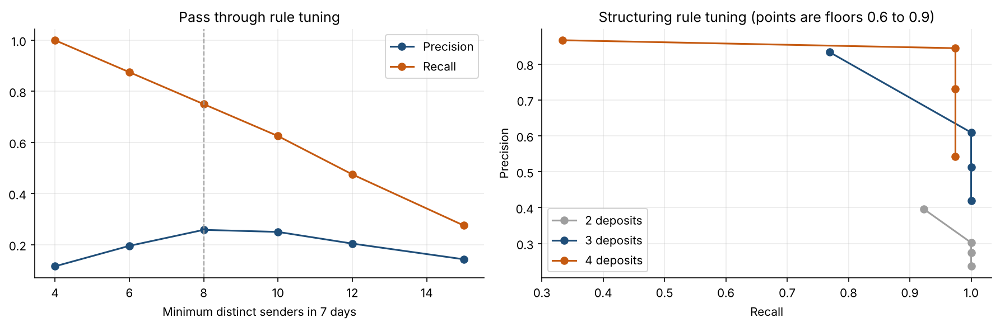

# AML Transaction Monitoring

[](https://github.com/LusandaNongogo/aml-transaction-monitoring/actions/workflows/tests.yml)

Transaction monitoring rules for structuring, money mules and dormant account abuse, with an alert triage model, a second line anomaly review and a tuning memo written for a compliance committee. Built around South African retail banking, including the customers that make monitoring hard: stokvels and cash heavy small businesses.

## Results

| Rule | Alerts | Precision | Recall on target |
| --- | ---: | ---: | ---: |
| Structuring | 64 | 61% | 100% |
| Pass through (mules) | 124 | 26% | 75% |
| Dormant reactivation | 23 | 91% | 100% |
| **All rules** | **208** | **43%** | **90%** |

- 77 of the 118 customers alerted in error are stokvels, which look like mule accounts on flows alone
- Moving the structuring rule from 3 to 4 deposits raises precision from 61% to 84% for the loss of 1 of 39 cases
- In triage order, investigators reach 99% of suspicious cases after working 100 of 208 alerts
- A second line anomaly review of 200 non alerted customers finds all 10 mules the rules missed



## What It Does

1. **Simulates** 5 000 customers and about 340 000 transactions in rand, with three planted typologies (structuring, mule, dormant reactivation) and three innocent look-alike groups (stokvels, small businesses, low activity accounts)
2. **Rules** with readable alert reasons, for example "20 senders in 7 days, R30,000 in and 98% sent out"
3. **Tuning** of each threshold with precision and recall trade offs
4. **Alert triage** with a gradient boosted model scored out of fold
5. **Anomaly model** (isolation forest) as a second line review of customers the rules did not alert
6. **Tuning memo** in `reports/tuning_memo.md`, written the way it would go to a compliance committee

## Why Simulated Data

Banks cannot publish labelled money laundering data, so even research benchmarks such as IBM AMLworld and PaySim are simulated. Simulating here means every case has a known answer, so alert precision and recall are exact. The trade off is that planted cases separate more cleanly than real ones, and the notebook and memo say where that inflates results.

## Project Structure

```
src/
  simulate.py   customers, transactions and planted typologies
  features.py   daily, rolling 7 day and customer level features
  rules.py      structuring, pass through and dormant reactivation rules
  model.py      isolation forest and alert triage model
  evaluate.py   precision, recall, precision at k and capacity curves
notebooks/
  aml_monitoring.ipynb   the full walk through with outputs
reports/
  tuning_memo.md         findings and recommendations
  figures/               saved charts
tests/                   pytest tests for the rules, metrics and simulator
```

## Setup (Windows)

```
git clone https://github.com/LusandaNongogo/aml-transaction-monitoring.git
cd aml-transaction-monitoring
py -m venv .venv
.venv\Scripts\activate
py -m pip install -r requirements.txt
py -m pytest
py -m jupyter notebook notebooks/aml_monitoring.ipynb
```

The cash threshold is R49 999.99, the section 28 FIC Act reporting level set by regulation 22B since 14 November 2022.
